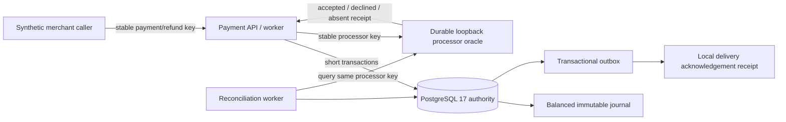

# Architecture

## Business view

The lab has three authorities with deliberately different meanings:

1. the synthetic merchant caller owns its request identity and desired economic intent;
2. PostgreSQL owns local payment/refund state, worker generations, balanced journal entries, outbox, and replay receipts;
3. the loopback processor oracle owns whether one synthetic external key was accepted or declined.

No distributed transaction spans PostgreSQL and the oracle. Correctness comes from durable preparation, stable replay, explicit
unknown state, and reconciliation of the same identity.



The arrow from the oracle to the worker may lose its response after the oracle has `fsync`ed acceptance. That is the central
failure window; it is resolved without creating a new processor key.

## Local state model

### Payment

```text
created -> capture_prepared -> capture_unknown -> captured
                         \-> declined
captured -> partially_refunded -> refunded
```

`capture_prepared` can reconcile directly to `captured` or `declined`; `capture_unknown` records observed communication ambiguity.
Refund state is derived from accepted/refund-reserved amounts and does not erase capture evidence. A stale worker result produces a
typed fence conflict and a reconciliation-required count rather than rewriting state.

### Processor attempt

```text
prepared -> unknown -> accepted
        \------------> declined
```

The attempt row exists before I/O. `unknown` means no matching external result has yet been applied locally; it never means the
oracle declined. Accepted/declined decisions are immutable and bind a receipt digest.

### Refund

```text
prepared -> unknown -> accepted
        \------------> declined
```

Prepared and unknown refunds reserve value. Accepted refunds consume it. Declined refunds release it. The payment row lock makes
the sum check and insertion one authority transition.

## Data model

| Table / durable store | Purpose and key constraints |
|---|---|
| `payment_intents` | immutable economics; one capture journal; state/version/generation |
| `operation_receipts` | `(operation, request_key)` to canonical digest and original JSON result |
| `processor_attempts` | immutable kind/aggregate/amount/currency/processor key; one decision/receipt |
| `refunds` | stable refund intent, reserved amount, one processor attempt and journal link |
| `journal_transactions` | one capture or refund effect, currency-bound and linked to external receipt |
| `journal_lines` | exactly two positive debit/credit lines; deferred constraint requires signed sum zero |
| `outbox_events` | immutable aggregate version/payload digest created in the financial transaction |
| `deliveries` | stable local acknowledgement identity and payload digest |
| `worker_assignments` | current generation for `capture`, `refund`, `reconcile`, and `delivery` |
| oracle JSONL | one canonical request and immutable synthetic decision per processor key, `fsync` before response |

## Capture write path

1. Create/replay payment intent in one PostgreSQL transaction.
2. Lock payment, verify `created` and expected generation, insert/replay capture attempt, commit.
3. Release every database lock, then POST the exact stored request to the oracle.
4. If transport fails, mark the attempt `unknown` without claiming decline.
5. If a matching receipt returns, begin a new transaction and lock worker assignment, attempt, and payment.
6. Recheck generation and immutable receipt. On accepted, insert journal transaction and two lines, link it to payment, increment
   version, and insert the outbox event. On declined, record decline without journal.
7. Commit. A deferred database constraint verifies the journal line count and signed sum.
8. If the response is lost after commit, the same attempt returns the linked stored result.

## Refund write path

1. Lock the captured payment and calculate reserved/accepted refunds from authority rows.
2. Reject if the new amount exceeds remaining value; otherwise insert stable refund and processor attempt in one transaction.
3. Dispatch outside the transaction with the stored processor key.
4. Apply accepted/declined receipt under worker, refund, and payment locks. Acceptance posts the exact reverse accounts, updates
   payment state/version, and creates one outbox event; decline releases reserved value.
5. Reconciliation uses the same finalizer, so dispatch replay and repair cannot create a second journal effect.

## Reconciliation path

For each bounded `prepared` or `unknown` attempt, the worker queries the oracle by its original key. A missing key stays unresolved;
a matching accepted/declined receipt runs the normal finalizer; a mismatched receipt is a typed evidence conflict. The run records
counts but does not invent a decision, new attempt, journal adjustment, or customer outcome.

## Concurrency and fencing

- Payment/refund value transitions lock the payment row; refund rows are inserted only after the locked aggregate sum is checked.
- Attempt finalization locks worker assignment before aggregate rows and verifies the prepared generation.
- Uniqueness on payment/refund journal links and outbox aggregate version blocks duplicate effects even if two workers race.
- Database deadlocks/serialization errors are retried only around local transactions. They never authorize replay under a new
  external identity.
- The oracle serializes its append/update section in one process and reconstructs its index from the durable log on restart.

## Why no wallet or payout

Chapter 27 is specifically a digital wallet case. Adding a stored merchant balance here would duplicate that system and blur the
boundary between external payment orchestration and internal value transfer. This lab retains a narrow merchant-payable journal
account but exposes no spendable wallet balance, transfer, payout, settlement, or withdrawal behavior.

## Failure containment

PostgreSQL unavailable means no local acceptance. Oracle unavailable means the prepared attempt becomes or remains unknown.
Journal constraint failure aborts the whole local outcome transaction. Outbox delivery failure cannot roll back a financial fact.
Generation conflict stops stale finalization and leaves the stable attempt available to the current reconciliation worker.
